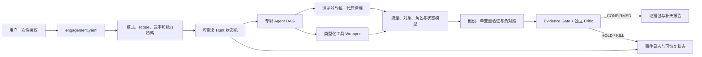

# BudoBugs

**Budo Autonomous Bug Bounty OS**

BudoBugs 是面向已授权 SRC、白盒源码审计和隔离靶场的本地优先漏洞研究系统。用户在
任务开始时提交一次授权声明、目标和测试账号引用；系统随后把攻击面建模、候选生成、
低影响验证、负对照、独立批判、证据归档和中文报告草拟组织为可中断、可恢复、可审计
的工作流。最终向 SRC 平台提交报告始终由人完成。

BudoBugs 不是任意目标扫描器。每次正式研究必须先建立并授权 `engagement.yaml`；所有
网络请求和工具 target 都要通过精确到 scheme、host、有效端口的 scope 检查。目标页面、
响应、源码注释、导入文件和第三方工具输出一律是不可信数据，不能改变授权、工具权限、
Shell 命令或报告门禁。

## 架构



核心是 Python 3.12 模块化单体：Pydantic v2 Schema、SQLite 状态、JSONL 事件、
Playwright 浏览器、Typer CLI、Textual TUI，以及 direct、HAR、Caido、Burp MCP、ZAP
统一代理接口。Docker Compose 提供 fixture、Juice Shop、WebGoat、crAPI 和 ZAP；
第三方工具由固定版本 registry、无 Shell 的参数向量 wrapper 和收据系统管理。

三个正式模式的权限不同：

- `lab`：只允许 localhost、私网或 Docker 内网目标，可执行完整主动验证和隔离的
  lab-ai 适配器。
- `program`：面向用户已明确授权的 SRC 目标；允许低变更验证、浏览器探索、Replay 和
  两个自有账号的权限差异测试，拒绝高变更、高资源和 lab-ai 自主执行。
- `source`：只访问声明的本地源码根，执行 Gitleaks、Semgrep、Trivy、OSV 及可达性关联。

详细设计见[架构概览](docs/architecture/OVERVIEW.md)、
[威胁模型](docs/architecture/THREAT_MODEL.md)和[架构决策](docs/decisions/)。

## 安装

需要 Python 3.12、[uv](https://docs.astral.sh/uv/)、Node.js 24 和 pnpm 11。完整本地靶场
还需要 Docker Desktop 或兼容 Docker daemon；Windows 的完整工具链建议使用 WSL2
Ubuntu。安装不会覆盖系统 Python、Conda、Node 或用户已有工具。

Windows PowerShell：

```powershell
git clone https://github.com/budoyh/BudoBugs.git
Set-Location BudoBugs
pwsh -NoProfile -File scripts/bootstrap.ps1
uv run playwright install chromium
uv run budo tools install --profile core --json
uv run budo doctor --json
```

Linux / WSL：

```bash
git clone https://github.com/budoyh/BudoBugs.git
cd BudoBugs
./scripts/bootstrap.sh
uv run playwright install chromium
uv run budo tools install --profile core --json
uv run budo doctor --json
```

`bootstrap` 只同步冻结的 Python/Node 依赖并验证发布输入；`tools install` 将固定版本工具
安装到 BudoBugs 专用用户目录。每个检查返回真实 `PASS`、`NEEDS_RUNTIME`、
`NEEDS_CREDENTIAL`、`NEEDS_LICENSE`、`UNSUPPORTED` 或 `FAIL`，不会把“登记过”当作可用。

## 一次性人工配置

代码无法替用户完成的事项只有：Docker daemon 启动、Caido PAT、Burp 及其许可证/BApp、
模型 API key、真实 SRC 自有测试账号，以及报告人工复核和提交。逐项步骤和秘密保存边界
见[一次性人工配置](docs/MANUAL_ONCE.md)。没有相关前置条件时，对应适配器保持明确的
非 PASS 状态，不影响 native fixture 和其他后端。

## 本地靶场

最快路径不依赖 Docker：

```powershell
uv run budo lab up --native-only --json
uv run budo lab status --json
```

完整 Compose 靶场和 ZAP：

```powershell
uv run budo lab up --extended --json
uv run budo lab status --json
uv run budo lab zap-scan --json
```

宿主机端口只绑定 `127.0.0.1`；靶场服务位于 `internal: true` 的 Docker 网络，唯一的
loopback 代理只转发固定端口。结束时运行：

```powershell
uv run budo lab down --json
```

`budo lab clean --yes` 会额外删除本项目 Compose volumes，只有明确不再需要靶场数据时
才运行。完整入门流程见 [First Lab](docs/tutorials/FIRST_LAB.md)。

## 创建并运行 Engagement

### 隔离 lab

```powershell
uv run budo engagement new --id first-lab --mode lab --target http://127.0.0.1:8765 --vendor local-fixture --attestation "I own and authorize this isolated local fixture."
uv run budo engagement validate first-lab --json
uv run budo engagement authorize first-lab --json
uv run budo hunt first-lab --json
```

### 已授权 program

以下示例只展示输入形态，不能把示例域名替换为未授权目标。`--target` 可重复，
`engagements/<id>/engagement.yaml` 可补充允许子域、排除目标、速率和备注。账号请求头先从
临时环境变量进入系统 keyring，engagement 仅保存引用：

```powershell
uv run budo engagement new --id vendor-src --mode program --target https://app.example.test --vendor Example --platform butian --attestation "I am authorized by this vendor to test exactly the declared targets."
$env:BUDO_ACCOUNT_A = '{"headers":{"Authorization":"Bearer <ACCOUNT_A_TOKEN>"}}'
$env:BUDO_ACCOUNT_B = '{"headers":{"Authorization":"Bearer <ACCOUNT_B_TOKEN>"}}'
uv run budo engagement account-set vendor-src --alias alice --headers-env BUDO_ACCOUNT_A --json
uv run budo engagement account-set vendor-src --alias bob --headers-env BUDO_ACCOUNT_B --json
Remove-Item Env:BUDO_ACCOUNT_A, Env:BUDO_ACCOUNT_B
uv run budo engagement validate vendor-src --json
uv run budo engagement authorize vendor-src --json
uv run budo hunt vendor-src --json
```

Program 模式只使用授权 scope 和已登记的自有测试账号。默认动作是登录后浏览、实时历史
检索、Replay 和只读差异请求；`POST/PUT/PATCH/DELETE` 只有在授权前登记为
`SafeExperimentTemplate`，并且正常对照、重复效果、负对照和清理验证均可机器闭合时才会
进入 typed executor。系统不会扩大读取第三方数据、自动提交、爆破、压测或执行高变更工具。

### 本地 source

```powershell
uv run budo engagement new --id local-source --mode source --target C:\path\to\authorized-source --vendor LocalProject --attestation "I own or am explicitly authorized to audit this source tree."
uv run budo engagement validate local-source --json
uv run budo engagement authorize local-source --json
uv run budo hunt local-source --json
```

## 中断恢复、流量和候选

先只跑到被动侦察，再从同一个 run 恢复：

```powershell
uv run budo hunt first-lab --phase recon --json
uv run budo status first-lab --json
uv run budo timeline first-lab --json
uv run budo hunt first-lab --resume --json
```

导入已授权 HAR、查看确定性流量模型和候选：

```powershell
uv run budo traffic import C:\path\to\authorized.har --engagement first-lab --account alice --json
uv run budo traffic summarize first-lab --json
uv run budo findings list first-lab --json
uv run budo findings show <finding-id> --json
uv run budo findings validate <finding-id> --json
```

只有 `CONFIRMED` 且独立 critic 通过全部 Evidence Gate 的 finding 能生成 submission-ready
报告；纯扫描器告警、缺少负对照、无能力增量或有更强正常解释的候选会进入 `HOLD` 或
`KILL`。

## 生成报告和证据包

```powershell
uv run budo report generate <finding-id> --platform butian --json
uv run budo report pack <finding-id> --json
```

输出包括 `report.md`、`report.html`、`finding.json`、证据 manifest 和人工复核清单。
ZIP 生成前会重新计算证据门并执行秘密/PII 扫描；生成不等于提交。详见
[报告生成与打包](docs/operations/REPORTING.md)。

## Caido、Burp 与 ZAP

```powershell
$env:CAIDO_PAT = '<PAT>'
uv run budo proxy caido-configure --url http://127.0.0.1:8080 --pat-env CAIDO_PAT --json
Remove-Item Env:CAIDO_PAT
uv run budo proxy doctor --json
uv run budo mcp doctor --json
```

- Caido 使用锁定的官方 `@caido/sdk-client` TypeScript bridge；PAT 进入 keyring，不写入
  Git、流量、日志或模型上下文。
- Burp 使用用户自行安装的 PortSwigger 官方 MCP BApp，默认只连接
  `http://127.0.0.1:9876/mcp`，并按服务实际 tools 检测 Community/Professional 能力。
- ZAP 2.17.0 以固定 digest 运行；daemon、history、replay、导出和 Automation Framework
  均受 engagement scope 约束。ZAP alert 仍只是候选信号。

详见 [Caido/Burp/ZAP 边界](docs/integrations/CAIDO_BURP_ZAP.md)。

## 模型与成本

`config/models.yaml` 提供 `quality-first` 和 `economy` 路由；`config/defaults.yaml` 记录
engagement/phase token budget、并发、timeout 和输出上限。默认 `agent_mode=disabled`，完整
确定性 hunt 不依赖云模型。启用前先运行不会执行 hunt 或访问 target 的预算预览，再显式启用：

```powershell
uv run budo hunt vendor-src --agent-mode codex --dry-run --json
uv run budo hunt vendor-src --agent-mode codex --json
```

每个阶段和 Agent turn 都保存耗时/成本、model、可恢复 thread、输入/输出 token、缓存和事件
收据。coordinator 先从当前确有安全候选的 allow-listed role 中生成 typed route；专业 Agent
只能在该持久化 assignment 的 action catalog 内选下一步，观察增益不足或候选变化时再路由。
浏览器、代理、HTTP、工具和 validator 动作由 BudoBugs 执行，并把 Observation 写回同一 Agent Loop。独立 critic 不能把未
通过证据门的候选升级。原始流量先在本地归一化、聚类、去重和脱敏，只传必要的结构化摘要。
模型 key 只能放环境变量或 keyring；费用、数据驻留和服务条款仍由用户确认。详见
[模型成本](docs/operations/MODEL_COSTS.md)。

## 隐私、秘密与授权边界

- `engagements/`、`runs/`、`findings/`、`.budobugs/`、真实 HAR、账号和未披露报告不进入 Git。
- Cookie、Authorization、token、邮箱、手机号和常见个人数据在日志与公开工件中脱敏；
  原始敏感证据只保存在本地 finding pack。
- Wrapper 不使用 Shell，不执行目标内容；路径、URL、参数、输出大小、timeout、重试和
  并发在真正的边界处校验。
- Program 禁止 DDoS、爆破、凭据填充、社会工程、恶意软件、持久化、横向移动、删除或
  修改第三方数据、批量下载真实敏感信息和自动提交。
- 发现第三方真实数据时只保留最小证明并停止扩大；最终报告必须由人复核。

完整政策见[数据处理](docs/operations/DATA_HANDLING.md)和
[负责任使用](docs/operations/RESPONSIBLE_USE.md)。

## 开发、测试与发布证据

```powershell
uv sync --frozen --extra dev
pnpm install --frozen-lockfile
uv run ruff check .
uv run ruff format --check .
uv run mypy src
pnpm run check
uv run pytest tests/unit tests/integration tests/e2e tests/security -m "not docker" --cov=budobugs --cov-report=term-missing --cov-fail-under=85
$env:BUDOBUGS_RUN_DOCKER_TESTS = "1"
uv run pytest -m docker tests/integration/test_docker_compose.py
uv run python scripts/verify_skills.py
uv run python scripts/verify_release.py --source
```

CI 还执行 ShellCheck、Hadolint、yamllint、markdownlint、真实 localhost E2E、Docker/ZAP
集成、Gitleaks、Semgrep、OSV、Trivy、Skill 测试、wheel 构建和干净环境安装 smoke。
发布证据位于 `release/`：CycloneDX SBOM、安全扫描原始 JSON、fixture 原始 Grype 结果、
source-bound OpenVEX 决策、Python/Node 生产许可证清单及 provenance。测试口径和准确命令
见[测试文档](docs/operations/TESTING.md)。

常见错误见[故障排查](docs/tutorials/TROUBLESHOOTING.md)。源码使用 Apache-2.0；外部
工具、运行时靶场和商业软件不会被重新授权或捆绑，详见
[第三方声明](THIRD_PARTY_NOTICES.md)、[许可证矩阵](docs/research/LICENSE_MATRIX.md)和
[上游评估](docs/research/UPSTREAM_EVALUATION.md)。
