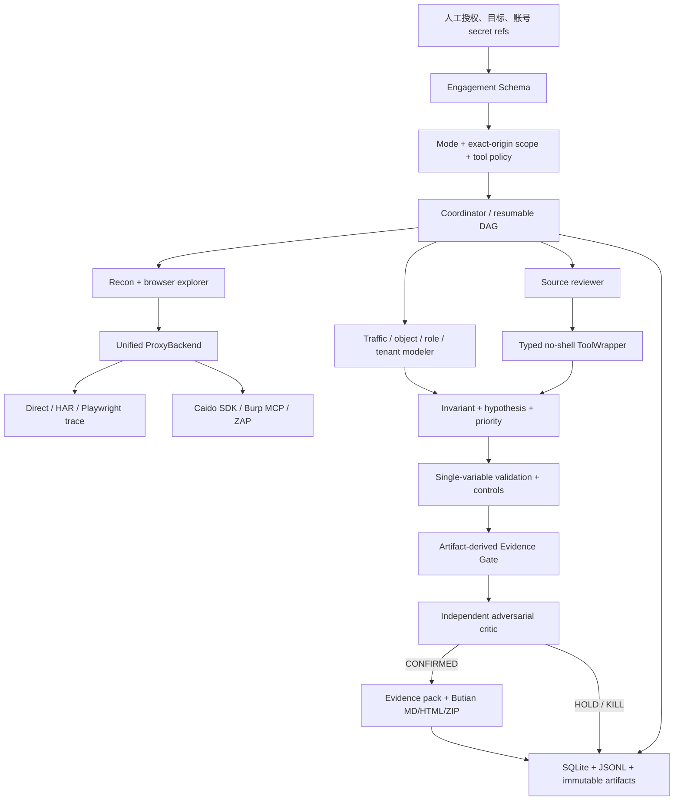

# 架构概览

## 模块和数据流

核心是 Python 3.12 模块化单体，不使用不必要的常驻微服务。Pydantic v2 定义 Engagement、
Run、Phase、ToolInvocation、HttpExchange、EndpointFamily、SecurityInvariant、Hypothesis、
ControlExperiment、Evidence、Finding、Critique、Report、CostRecord 和 AuditEvent。SQLite
保存可查询状态；JSONL 保存追加式事件；大型/原始工件保存在 run/finding 目录并由 manifest
关联。主聊天不是状态来源。

HuntEngine 实现从 `INIT` 到 `HUMAN_REVIEW_READY` 的阶段状态机。每阶段先持久化开始事件，
再写入 Schema 化输出和结束事件；中断后 `--resume` 读取同一 run 的已完成阶段，而不是创建
一个看似成功的新 run。`--phase recon` 是可验证的中断点。

12 个 Agent 配置位于 `.codex/agents/`：coordinator、recon、traffic、browser、authorization、
API/session、web client、business logic、source review、evidence validation、adversarial critic 和
report writer。Tool operation 由受控 wrapper 加 `tool-operator` Skill 承担；成本/上下文由
coordinator 的路由和预算策略承担。它们共享 Schema 工件而非隐式对话；critic 与候选生成职责
分离。`.agents/skills/` 的 14 个 Skills 提供输入/输出契约和可执行校验器。

## 权限和工具边界

Profile 只是安装集合，不是执行授权。`lab`、`program`、`source` 的目标和工具请求都经过
同一 policy：

- Web/API scope 使用 scheme + normalized host + effective port；URL 中的用户名/密码拒绝。
- Optional subdomain 仍必须匹配 root 的 scheme/port；excluded target 优先拒绝。
- Source path resolve 后必须位于授权 root，路径遍历或 sibling prefix 不通过。
- Program 阻断 medium/high mutation、high resource risk 和 lab-ai；两账号动态验证为 scoped
  GET-only。
- Lab 网络目标必须是 loopback/private/Docker 名称；浏览器 route guard 同时拦截跨 scope
  subresource 和 redirect。

工具 wrapper 只接受类型化参数向量，不使用 Shell；target 由 engagement 注入。Wrapper 统一
处理参数 allowlist、timeout、最多一次受控重试、并发/输出上限、退出码、脱敏 stdout/stderr、
原始 lab/source 工件权限和执行收据。目标响应、文件名、源码注释和工具输出不会成为命令。

## 代理和浏览器

`ProxyBackend` 统一 history search、get、replay、single request 和 export：HAR/direct 可完全
离线，Playwright trace 记录浏览器证据，Caido 使用官方 SDK bridge，Burp 使用官方 MCP BApp，
ZAP 使用 daemon/API/Automation Framework。Health PASS 只证明一次协议或运行探测成功，不证明
target scope、授权、许可证或 finding。

Playwright 为账号使用隔离 context，记录 HAR、trace、screenshot、DOM/route 和操作步骤；
Cookie/token 在公开日志中脱敏。登录、MFA 和验证码可由用户完成一次，随后仅保存 secret ref。

## 证据与发布边界

Finding 只有在复现、能力增量、正常/负对照、最强正常解释反证、影响、清理、证据完整性和
独立 critic 全部从实际工件重新计算通过时，才能进入 `READY_FOR_HUMAN_REVIEW`。报告生成和 ZIP
打包再次计算门禁与 secret scan；自报状态或模板文字不能制造 PASS。

研究数据默认位于 `.budobugs/`、`engagements/`、`runs/` 和 `findings/` 并排除 Git；仓库只
保留脱敏 fixtures 和 release evidence。第三方工具、浏览器、GUI 代理、lab-ai 和训练镜像位于
进程/容器/用户数据边界，不因 registry 记录而被捆绑或重新授权。
